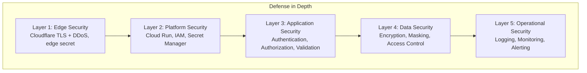
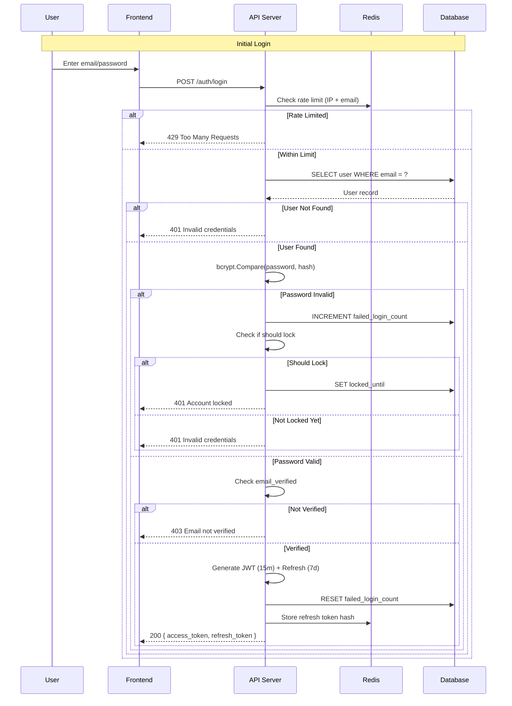
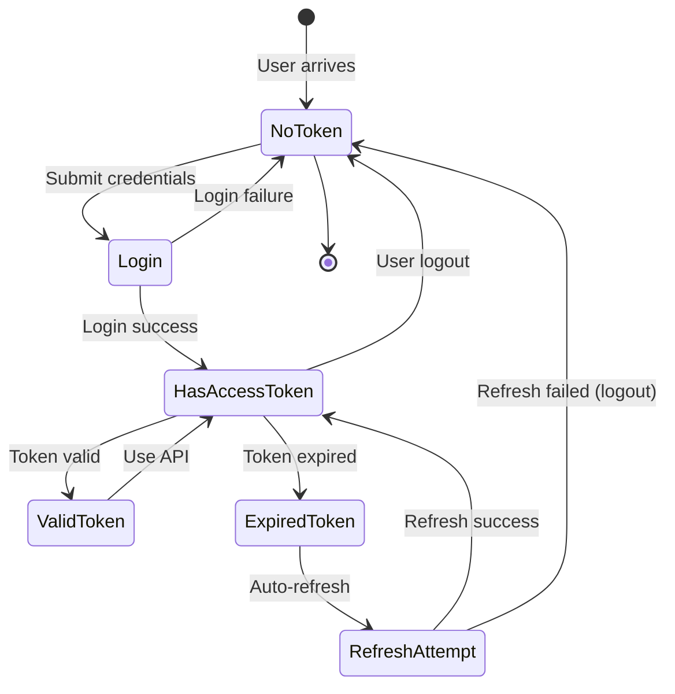
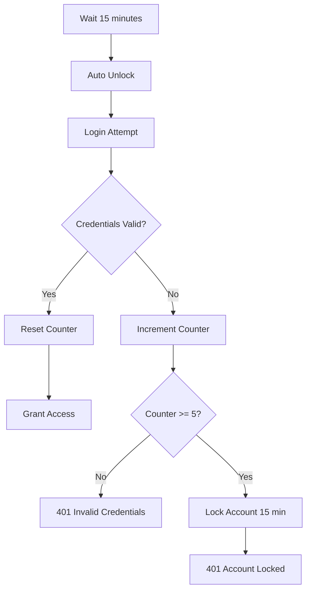
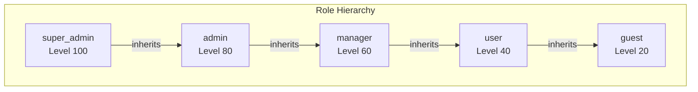
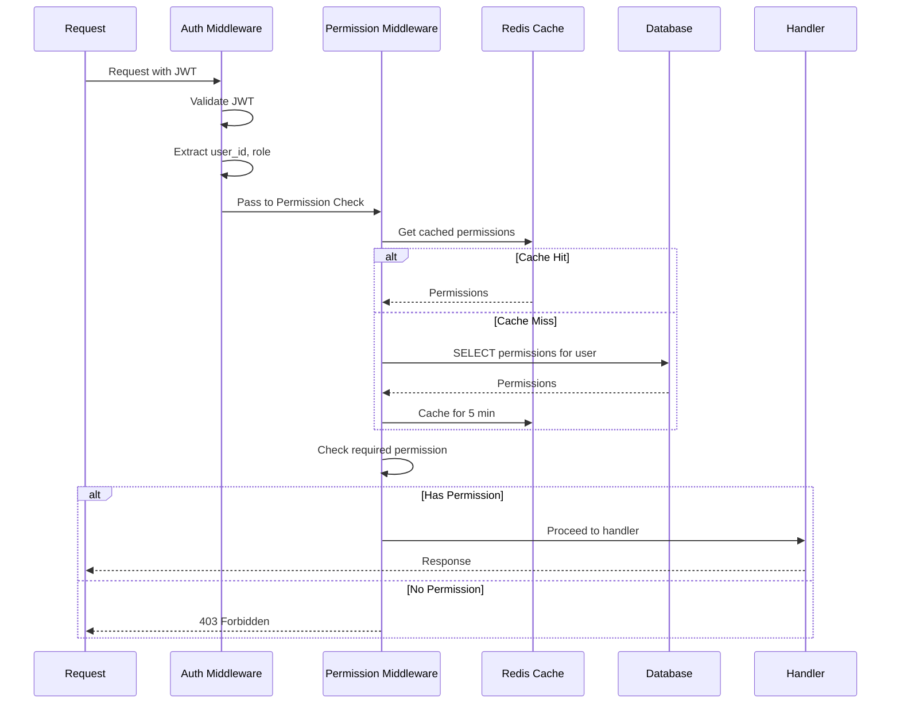
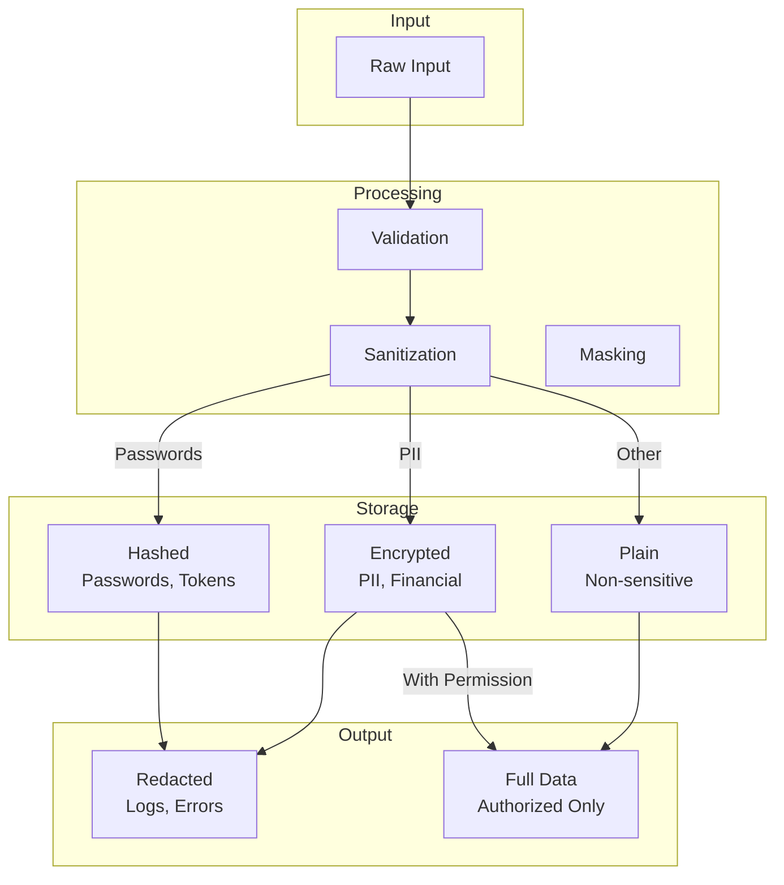
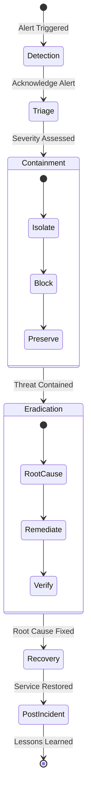

# ServicePro Security Architecture

> **Classification**: Internal
> **Version**: 1.1
> **Last Updated**: 2026-10-25
>
> **Production (live since v0.9.0, 2026-10-24):** Cloudflare Worker
> `servicepro-web` (edge, TLS, static assets, `/api` proxy) → Google Cloud Run
> `servicepro-api` (us-east5) → Neon Postgres 18 (AWS us-east-2). There is no
> AWS account, VPC, WAF ruleset or ECS in this architecture; sections below
> describe the controls that actually exist. Security findings and fixes are
> tracked in `docs/audits/2026-10-16/` and TODO.md Phase 1.

## Table of Contents

1. [Security Overview](#1-security-overview)
2. [Authentication](#2-authentication)
3. [Authorization](#3-authorization)
4. [Data Protection](#4-data-protection)
5. [Network Security](#5-network-security)
6. [Application Security](#6-application-security)
7. [Infrastructure Security](#7-infrastructure-security)
8. [Compliance](#8-compliance)
9. [Security Monitoring](#9-security-monitoring)
10. [Incident Response](#10-incident-response)

---

## 1. Security Overview

### 1.1 Security Principles

ServicePro follows defense-in-depth security principles:



### 1.2 Security Domains

| Domain                      | Responsibility             | Key Controls                |
| --------------------------- | -------------------------- | --------------------------- |
| **Identity & Access**       | Who can access what        | JWT, RBAC, MFA              |
| **Data Protection**         | Protecting sensitive data  | Encryption, Masking, Backup |
| **Network Security**        | Secure communications      | TLS, edge-only API access   |
| **Application Security**    | Secure code practices      | Input validation, OWASP     |
| **Infrastructure Security** | Secure hosting environment | GCP IAM, WIF, image scanning |
| **Operations Security**     | Secure operations          | Logging, Monitoring, IR     |

---

## 2. Authentication

### 2.1 Authentication Architecture



### 2.2 JWT Token Structure

```
Header:
{
  "alg": "HS256",
  "typ": "JWT"
}

Payload:
{
  "sub": "user-uuid",           // Subject (user ID)
  "email": "user@example.com",  // User email
  "role": "manager",            // Primary role
  "iat": 1700000000,            // Issued at
  "exp": 1700000900,            // Expires (15 minutes)
  "iss": "servicepro",          // Issuer
  "jti": "unique-token-id"      // Token ID for revocation
}

Signature:
HMACSHA256(
  base64UrlEncode(header) + "." + base64UrlEncode(payload),
  JWT_SECRET
)
```

### 2.3 Token Lifecycle



### 2.4 Password Security

| Control               | Implementation                             |
| --------------------- | ------------------------------------------ |
| **Hashing Algorithm** | bcrypt with cost factor 12                 |
| **Minimum Length**    | 8 characters                               |
| **Complexity**        | Must contain: uppercase, lowercase, number |
| **History**           | Cannot reuse last 5 passwords              |
| **Expiration**        | Optional, configurable by admin            |
| **Reset**             | Token-based, 1-hour expiry                 |

### 2.5 Account Lockout



---

## 3. Authorization

### 3.1 Role-Based Access Control (RBAC)



### 3.2 Permission Model

Permissions follow the format: `resource.action`

**Resources:**

- `users` - User accounts
- `roles` - Role definitions
- `permissions` - Permission definitions
- `customers` - Customer records
- `jobs` - Job/work orders
- `quotes` - Quotes
- `invoices` - Invoices
- `payments` - Payments
- `reports` - Analytics reports
- `settings` - System settings

**Actions:**

- `create` - Create new records
- `read` - View records
- `update` - Modify records
- `delete` - Delete records
- `list` - List/search records
- `manage` - Full control
- `assign` - Assign resources
- `approve` - Approve workflows

### 3.3 Default Role Permissions

| Permission       | super_admin | admin | manager | user | guest |
| ---------------- | :---------: | :---: | :-----: | :--: | :---: |
| users.manage     |      ✓      |   ✓   |         |      |       |
| roles.manage     |      ✓      |       |         |      |       |
| customers.create |      ✓      |   ✓   |    ✓    |      |       |
| customers.read   |      ✓      |   ✓   |    ✓    |  ✓   |   ✓   |
| customers.update |      ✓      |   ✓   |    ✓    |      |       |
| customers.delete |      ✓      |   ✓   |         |      |       |
| jobs.create      |      ✓      |   ✓   |    ✓    |      |       |
| jobs.read        |      ✓      |   ✓   |    ✓    |  ✓   |   ✓   |
| jobs.update      |      ✓      |   ✓   |    ✓    |  ✓   |       |
| jobs.delete      |      ✓      |   ✓   |         |      |       |
| invoices.create  |      ✓      |   ✓   |    ✓    |      |       |
| invoices.read    |      ✓      |   ✓   |    ✓    |  ✓   |       |
| invoices.manage  |      ✓      |   ✓   |         |      |       |
| reports.view     |      ✓      |   ✓   |    ✓    |      |       |
| settings.manage  |      ✓      |   ✓   |         |      |       |

### 3.4 Permission Check Flow



---

## 4. Data Protection

### 4.1 Encryption

#### At Rest

| Data             | Where                         | Encryption                      |
| ---------------- | ----------------------------- | ------------------------------- |
| Database         | Neon Postgres (AWS us-east-2) | Provider-managed at rest        |
| Secrets          | GCP Secret Manager            | Google-managed keys             |
| Backups          | Cloudflare R2 (T209, not active yet) | Provider-managed at rest |
| Passwords        | `users.password_hash`         | bcrypt, cost 12 (not reversible) |

#### In Transit

| Connection             | Protection                                                   |
| ---------------------- | ------------------------------------------------------------ |
| Browser → Worker       | HTTPS (Cloudflare certificate for `servicepro.sharkfins.xyz`), HSTS |
| Worker → Cloud Run     | HTTPS to the `*.run.app` URL, plus `X-SP-Edge-Secret`        |
| Cloud Run → Neon       | TLS (`sslmode=require` in the connection string)             |
| Cloud Run → Redis      | `rediss://` (TLS) when Redis is configured                   |

### 4.2 Sensitive Data Handling



### 4.3 PII Data Classification

| Classification         | Examples              | Controls                                |
| ---------------------- | --------------------- | --------------------------------------- |
| **High Sensitivity**   | SSN, Payment Cards    | Encrypted, Limited access, Audit logged |
| **Medium Sensitivity** | Email, Phone, Address | Encrypted at rest, Role-based access    |
| **Low Sensitivity**    | Names, Company        | Standard protection                     |
| **Public**             | Invoice numbers       | No special protection                   |

### 4.4 Data Retention

| Data Type     | Retention                   | Deletion Method            |
| ------------- | --------------------------- | -------------------------- |
| User Accounts | Until deletion requested    | Soft delete + 30-day purge |
| Customers     | 7 years after last activity | Anonymization              |
| Invoices      | 7 years (legal requirement) | Archive to cold storage    |
| Jobs          | 5 years                     | Archive                    |
| Audit Logs    | 2 years                     | Rotate to archive          |
| Session Data  | 24 hours                    | Auto-expire                |

---

## 5. Network Security

### 5.1 Request Path

```
Browser ──HTTPS──► Cloudflare Worker "servicepro-web"
                     │ static assets; /api/* and /version proxied
                     │ sets X-SP-Client-IP + X-SP-Edge-Secret, strips spoofed copies
                     ▼
                   Cloud Run "servicepro-api" (us-east5, public *.run.app URL)
                     │ ENV=production: /api/* without a valid X-SP-Edge-Secret → 403
                     ▼
                   Neon Postgres 18 (TLS)
```

- The `*.run.app` URL is public (Cloud Run `--allow-unauthenticated`; the API
  does its own auth), but `/api/*` only answers traffic that came through the
  Worker. `/health/*`, `/version` and `/internal/jobs/*` (own token) are
  reachable directly.
- Client IPs come only from `X-SP-Client-IP` with a valid edge secret
  (`middleware.ClientIP`); `X-Forwarded-For` is never trusted directly.
- `/internal/jobs/*` requires `X-Internal-Jobs-Token` (404 when the secret is
  unset) and is never proxied by the Worker.
- `/metrics` requires a bearer token outside development.

### 5.2 Edge Protection

Cloudflare terminates TLS and provides its standard DDoS protection for the
zone. No custom WAF rules are configured today.

---

## 6. Application Security

### 6.1 OWASP Top 10 Mitigations

| Vulnerability                        | Mitigation                                         |
| ------------------------------------ | -------------------------------------------------- |
| **A01: Broken Access Control**       | RBAC, permission checks on every endpoint          |
| **A02: Cryptographic Failures**      | TLS 1.3, AES-256 encryption, secure key management |
| **A03: Injection**                   | Parameterized queries (GORM), input validation     |
| **A04: Insecure Design**             | Threat modeling, security reviews                  |
| **A05: Security Misconfiguration**   | Infrastructure as code, security scanning          |
| **A06: Vulnerable Components**       | Dependency scanning, auto-updates                  |
| **A07: Authentication Failures**     | JWT, rate limiting, account lockout                |
| **A08: Software Integrity Failures** | Signed artifacts, code review                      |
| **A09: Logging Failures**            | Comprehensive audit logging                        |
| **A10: SSRF**                        | Allowlist external calls, disable redirects        |

### 6.2 Input Validation

```go
// Example: Customer creation validation
type CreateCustomerRequest struct {
    FirstName    string `json:"first_name" validate:"required,min=1,max=100"`
    LastName     string `json:"last_name" validate:"required,min=1,max=100"`
    Email        string `json:"email" validate:"required,email"`
    Phone        string `json:"phone" validate:"omitempty,e164"`
    CustomerType string `json:"customer_type" validate:"required,oneof=residential commercial"`
}

// Validation occurs at:
// 1. JSON binding (type checking)
// 2. Struct validation (business rules)
// 3. Database constraints (uniqueness, foreign keys)
```

### 6.3 Rate Limiting

Defaults (configurable with `RATE_LIMIT_*`, 1-minute window; Redis-backed when
configured, otherwise per instance):

| Caller / endpoint      | Limit                                  | Key              |
| ---------------------- | -------------------------------------- | ---------------- |
| Anonymous              | 100 requests / minute                  | IP               |
| Authenticated          | 1000 requests / minute                 | User (Neon `sub` for Neon Auth tokens) |
| Admin endpoints        | 50 requests / minute                   | User             |
| Login                  | Throttled with backoff                 | Email + IP       |
| Password reset request | Throttled                              | Email + IP       |
| Public invoice pay links (`/public/invoices/*`) | 20 requests / minute | IP |

### 6.4 Security Headers

```
Strict-Transport-Security: max-age=31536000; includeSubDomains; preload
Content-Security-Policy: default-src 'self'; script-src 'self' 'unsafe-inline' https://js.stripe.com
X-Content-Type-Options: nosniff
X-Frame-Options: DENY
X-XSS-Protection: 1; mode=block
Referrer-Policy: strict-origin-when-cross-origin
Permissions-Policy: geolocation=(), microphone=(), camera=()
```

---

## 7. Infrastructure Security

### 7.1 Platform

| Control                    | Implementation                                                                  |
| -------------------------- | ------------------------------------------------------------------------------- |
| Deploy credentials         | GitHub Actions → Workload Identity Federation (no stored GCP keys), pinned to this repo |
| Service accounts           | `gh-deploy` (push images, roll revisions) and `servicepro-api` runtime SA (read its secrets only) |
| Image scanning             | CI builds the Docker image and scans it with Trivy; `govulncheck` and `npm audit` in CI and weekly |
| Releases                   | Only `v*` tags deploy; migrations run before the new revision takes traffic     |
| Dependencies               | Dependabot; patch/minor auto-merged after green CI                               |

### 7.2 Secrets Management

| Secret                                   | Storage                                   |
| ---------------------------------------- | ----------------------------------------- |
| `DATABASE_URL`, `JWT_SECRET`             | GCP Secret Manager (mounted into Cloud Run) |
| Stripe, Resend, Sentry, PostHog, Redis, `INTERNAL_JOBS_SECRET`, `EDGE_PROXY_SECRET` | GCP Secret Manager (attached when present) |
| `EDGE_PROXY_SECRET` (edge side)          | Cloudflare Worker secret                  |
| `MIGRATION_DATABASE_URL`, Cloudflare and R2 tokens | GitHub Actions secrets          |

Secrets never live in the repository (it is public); `.env` files are
gitignored. Rotation is manual today. Setup details:
[docs/ops/cloud-run-setup.md](../ops/cloud-run-setup.md).

---

## 8. Compliance

### 8.1 Compliance Framework

| Framework     | Applicability                 | Status         |
| ------------- | ----------------------------- | -------------- |
| SOC 2 Type II | Service organization controls | In progress    |
| GDPR          | EU customer data              | Compliant      |
| PCI DSS       | Payment card handling         | Stripe handles |
| CCPA          | California consumer privacy   | Compliant      |

### 8.2 Data Subject Rights (GDPR/CCPA)

| Right             | Implementation            |
| ----------------- | ------------------------- |
| **Access**        | Export user data via API  |
| **Rectification** | Update profile endpoint   |
| **Erasure**       | Account deletion workflow |
| **Portability**   | JSON/CSV data export      |
| **Restriction**   | Account suspension        |
| **Object**        | Marketing opt-out         |

---

## 9. Security Monitoring

### 9.1 Monitoring

| Source                    | Where it goes                                                        |
| ------------------------- | -------------------------------------------------------------------- |
| API logs (structured, with `request_id`, no PII/tokens) | Cloud Run → Google Cloud Logging        |
| API and SPA errors        | Sentry (when `SENTRY_DSN` is set)                                    |
| Product analytics         | PostHog (tokens, emails and query strings stripped)                  |
| Metrics                   | Prometheus `/metrics` (token-protected); Grafana locally only        |
| Uptime / status page      | Better Stack — planned                                               |
| Failed scheduled jobs / backups | GitHub Actions failure emails                                  |

### 9.2 Security-Relevant Signals

| Signal                         | Control today                                         |
| ------------------------------ | ----------------------------------------------------- |
| Repeated failed logins         | Login throttling (429) and account lockout            |
| Cross-tenant access attempts   | 404 (tenant-scoped queries), 403 for non-members      |
| Role escalation attempts       | Rejected; `super_admin` is never assignable via API   |
| Forged cross-site requests     | 403 `csrf_check_failed`                               |
| Direct-to-Cloud-Run API calls  | 403 without the edge secret                           |

### 9.3 Audit Logging

All security-relevant events are logged:

```json
{
  "timestamp": "2026-01-17T10:30:00Z",
  "event_type": "authentication.login_success",
  "user_id": "uuid",
  "email": "user@example.com",
  "ip_address": "1.2.3.4",
  "user_agent": "Mozilla/5.0...",
  "geo_location": "US",
  "session_id": "session-uuid",
  "request_id": "request-uuid"
}
```

---

## 10. Incident Response

### 10.1 Incident Severity Levels

| Level           | Description                  | Response Time | Examples                           |
| --------------- | ---------------------------- | ------------- | ---------------------------------- |
| **P1 Critical** | Service down or data breach  | 15 minutes    | Data leak, complete outage         |
| **P2 High**     | Major functionality impacted | 1 hour        | Auth system down, payment failures |
| **P3 Medium**   | Minor functionality impacted | 4 hours       | Feature degradation                |
| **P4 Low**      | No user impact               | 24 hours      | Security scan finding              |

### 10.2 Incident Response Process



### 10.3 Contact Information

| Role                      | Contact                        | Escalation Path |
| ------------------------- | ------------------------------ | --------------- |
| Security / support        | support@sharkfins.xyz          | Owner (direct)  |

ServicePro is run by a single owner today; there is no on-call rotation.

---

## Document History

| Version | Date    | Author        | Changes               |
| ------- | ------- | ------------- | --------------------- |
| 1.0     | 2026-01 | Security Team | Initial documentation |

---

_This document is reviewed quarterly and updated as security controls evolve._
